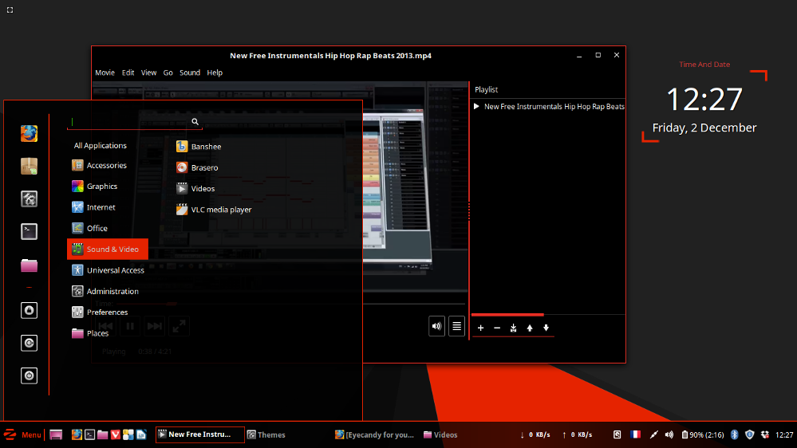

# Vivaldi-ZorinOS

A black theme with red highlights for Cinnamon, GTK 2, GTK 3, GTK 4, Qt 5 and Qt 6 applications, and the Metacity and Openbox window managers.



## Supported versions

- **Cinnamon:** 4.x to 6.8. Newer Cinnamon parts are styled without breaking older versions.
- **GTK 3:** 3.20 and later.
- **GTK 4:** including libadwaita applications that follow `GTK_THEME`.
- **Qt 5 and Qt 6:** through qt5ct and qt6ct with the Fusion style.

## Installation

Install the theme from **System Settings → Themes → Add/Remove**, or place the `Vivaldi-ZorinOS` folder from `files/` in `~/.themes/` (just you) or `/usr/share/themes/` (all users).

### GTK 4 and libadwaita applications

GTK 4 applications follow the theme chosen in System Settings, but libadwaita applications only use it when `GTK_THEME` is set. To use it in those as well, set it for your session, for example in `~/.config/environment.d/gtk-theme.conf`:

```
GTK_THEME=Vivaldi-ZorinOS
```

### Qt applications

1. Install qt5ct (Qt 5) and qt6ct (Qt 6), and set `QT_QPA_PLATFORMTHEME=qt5ct` for your session. qt6ct reads the same variable.
2. Copy the files from the theme's `qt5ct` folder. The same files work for both:

   ```bash
   for v in qt5ct qt6ct; do
       mkdir -p ~/.config/$v/colors ~/.config/$v/qss
       cp ~/.themes/Vivaldi-ZorinOS/qt5ct/colors/Vivaldi-ZorinOS.conf ~/.config/$v/colors/
       cp ~/.themes/Vivaldi-ZorinOS/qt5ct/qss/Vivaldi-ZorinOS.qss ~/.config/$v/qss/
   done
   ```

3. In qt5ct and in qt6ct:
   - On the **Appearance** tab, choose the **Fusion** style and the **Vivaldi-ZorinOS** custom colour scheme.
   - On the **Style Sheets** tab, tick **Vivaldi-ZorinOS.qss**.

## Credits

- **freemangilgamesh:** author of Vivaldi-ZorinOS.
- **Zorin Group:** the Zorin OS GTK and Openbox themes it is based on.
- **SyberHexen:** updates for Cinnamon 4.x to 6.8, the port to GTK 3.20 and later, GTK 4 and Qt support.

## License

GPL-3.0-or-later, as the Zorin OS GTK theme it is based on.
